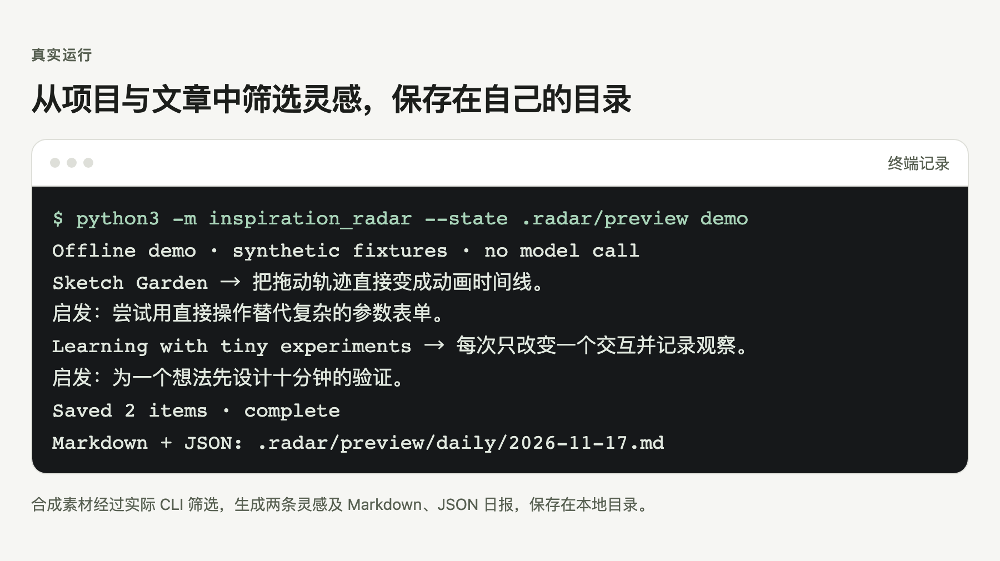

# 灵感雷达 · inspiration-radar

为开发者生成 GitHub 项目与文章灵感日报，核验证据后永久去重。

<picture>
  <source media="(prefers-color-scheme: dark)" srcset="docs/readme/hero-dark.zh-CN.png">
  
</picture>

实际 CLI 输出；合成素材、预置评分，未调用模型。[English image](docs/readme/hero-light.png) · [Dark](docs/readme/hero-dark.png)

## 快速开始

```sh
git clone https://github.com/bmdy6/inspiration-radar.git
cd inspiration-radar
python3 -m venv .venv && .venv/bin/python -m pip install .
.venv/bin/inspiration-radar --state .radar/demo demo
```

需要 Python 3.10+。安装后运行零第三方依赖；demo 离线生成 `.radar/demo/daily/2026-11-17.md` 和同名 JSON。示例链接是虚构占位。

## 得到什么

- **先看证据，再收录。** 只有标记已核验、五维评分与证据齐全的条目才进入日报。
- **每天保留一份确定结果。** 同日重跑复用首批结果，跨日按规范化链接永久去重。
- **产物留在自己的目录。** 输出 Markdown 和 JSON，默认不调用模型、不安装定时任务。

## 日常使用

1. 执行 `discover` 获取公开 GitHub / Hacker News 候选，或导入其他来源的候选 JSON。
2. 用 `prompt` 导出核验要求，交给自己的 Agent 阅读原文，产出带证据的评分 JSON。
3. 执行 `publish` 筛选并保存本地日报。每条保留“它是什么、最有意思的点、启发、原始链接”。

```sh
.venv/bin/inspiration-radar discover > candidates.json
.venv/bin/inspiration-radar prompt > review-prompt.txt
```

评分示例、发布命令、配置与可选定时执行见[使用说明](docs/usage.md)。实际候选未核验前不会自动发布。

## 配置

| 配置 | 用途 |
|---|---|
| `--config config/default.json` | 调整主题、排除词、五维权重与阈值。 |
| `--state DIRECTORY` | 为每个主题选择独立状态目录；演示和正式数据分开。 |
| `GITHUB_TOKEN` | 可选，提升公开 GitHub 搜索额度；默认匿名读取。 |
| `RADAR_STATE_DIR` | 默认状态目录；命令行参数优先。 |

`.env.example` 只列配置项，程序不会自动读取 `.env`。未知日期、超出默认 90 天和未核验的内容会跳过，每批默认最多 5 条。

## 常见问题

**一定需要模型吗？** 不需要。可以人工核验评分，也可以使用自己的 DeepSeek 或其他 Agent。程序本身不保存模型密钥、不发模型请求，评分是判断而非事实认证。

**能直接推送到聊天群或网页吗？** 当前版本只生成本地文件。自建消费者可读取日报；来源内容视为不可信文本，不执行其中的指令。

**来源失败会发生什么？** 每个来源有独立状态，部分失败返回 `partial`，全部失败非零退出。发现阶段不写已发布状态；网络可用性和候选数量随来源变化。

**能每天自动运行吗？** 可以自己调度候选获取、Agent 核验与发布三个步骤。仓库不会自动安装任务；无需调度也能手动运行。

## 参与开发

运行 `python3 -m unittest discover -s tests -v`；欢迎提交来源适配与失败场景测试。截图来源和复现文件见 [README 证据](docs/readme/SOURCES.md)。

## 许可

[MIT](LICENSE)。
